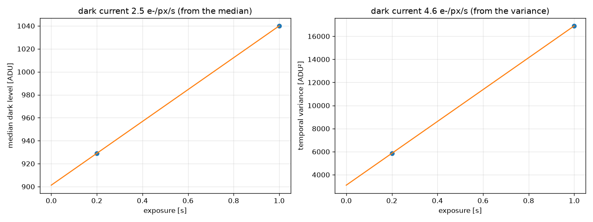
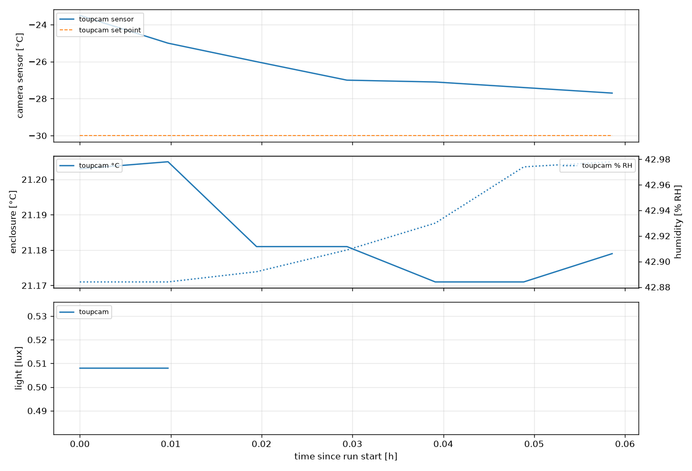
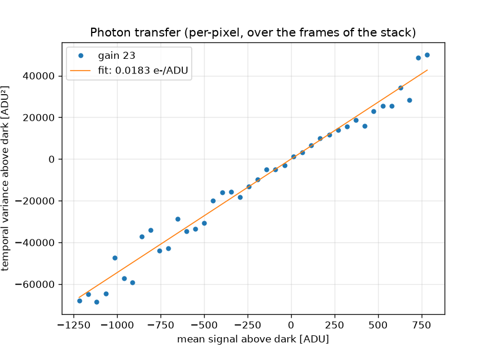
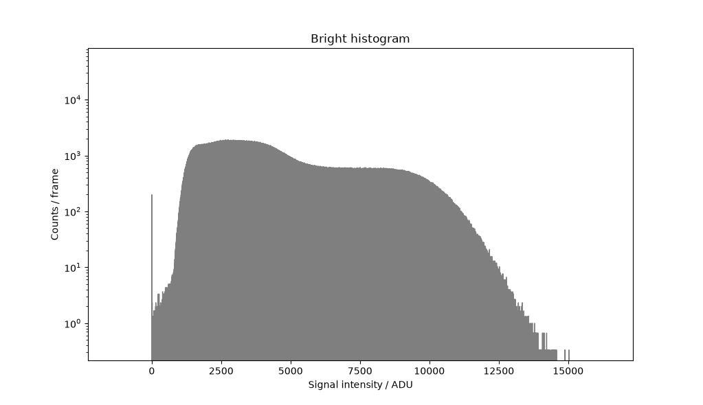
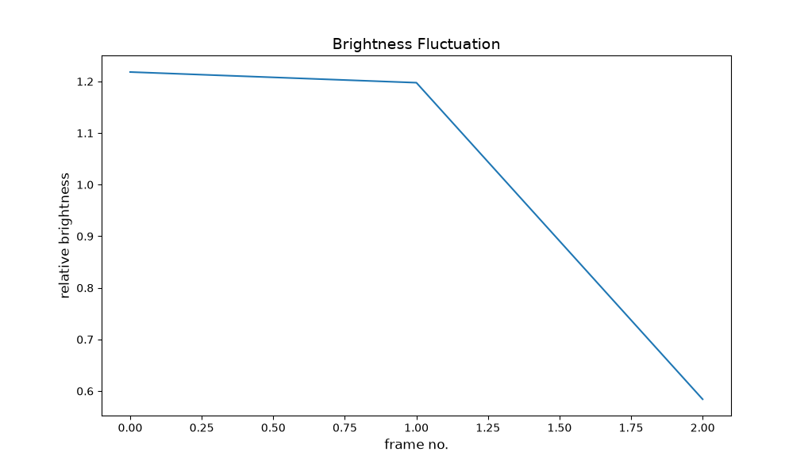
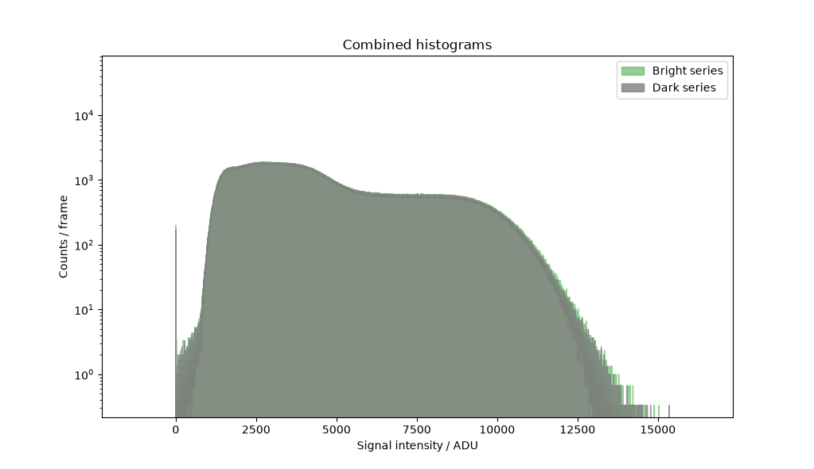
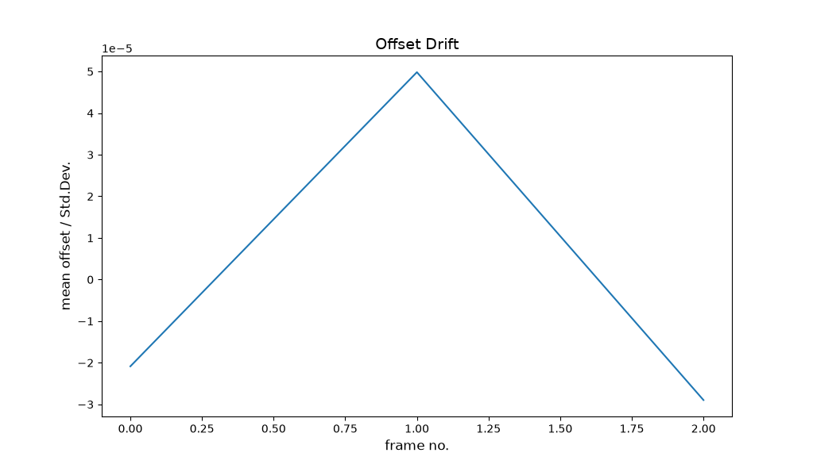
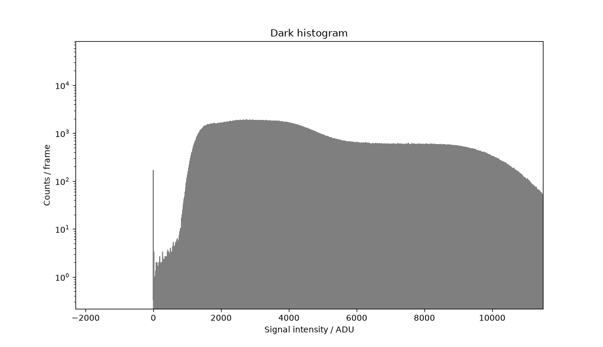
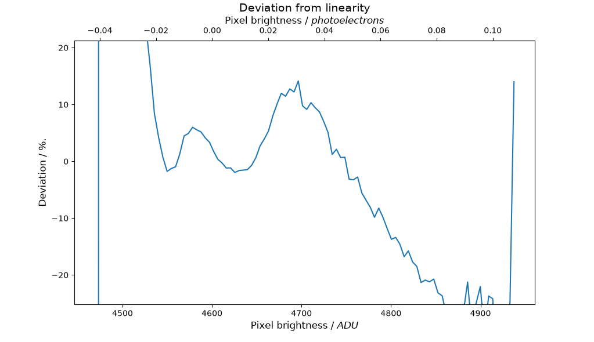
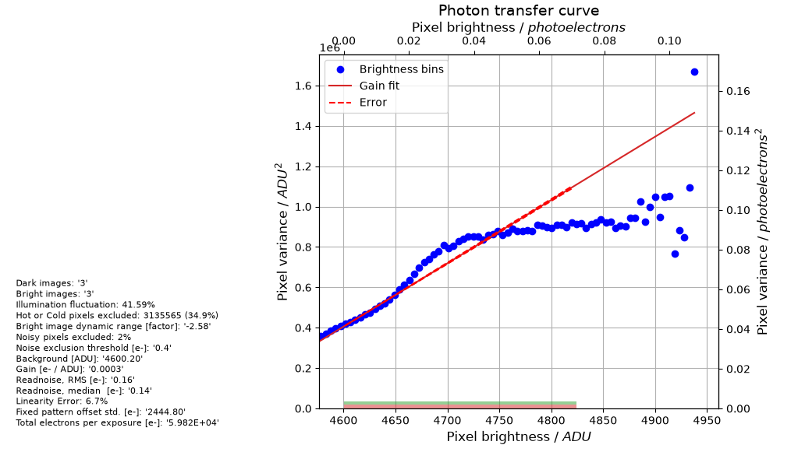

# E2 - ToupTek photon-transfer calibration

Photon-transfer calibration of the ToupTek MTR3CMOS09000KMA at the operating point of E4 (gain 23, HCG, black level 1000, -30 °C), with the beta light mounted directly in front of the sensor, followed by a dark ladder. Gives the conversion gain (e-/ADU), read noise and offset, and the dark current in e-/px/s, to settle the factor ~10 between the datasheet and what was measured so far.

| | |
|---|---|
| Run | `2026-10-24_14-07-47_touptek_ptc` |
| Experiment | E2 |
| Server / detector | http://localhost:8001/imswitch/api / WidefieldCamera |
| Frames | 4 |
| First / last frame | 2026-10-24T14:10:21 / 2026-10-24T14:10:46 |
| **Dry run** | short test exposures, not data |

## Summary


| gain_ui | exposure_ms | e_per_adu | read_noise_e | offset_adu | e_per_adu_temporal | read_noise_e_temporal |
|---|---|---|---|---|---|---|
| 23 | 1000 | 0.0003188 | 0.1614 | 4600 | 0.01835 | 8.026 |

- **dark_ladder_exposures_s:** [0.2, 1.0]
- **dark_slope_adu_per_s:** 138.8
- **dark_variance_slope_adu2_per_s:** 1.38e+04
- **e_per_adu_used:** 0.01835
- **dark_current_e_px_s_from_mean:** 2.546
- **dark_current_e_px_s_from_variance:** 4.648
- **ratio_to_datasheet_mean:** 5092
- **ratio_to_datasheet_variance:** 9295
- **camera_temperature_c_min_max:** [-27.7, -23.5]
- **enclosure_temperature_c_min_max:** [21.171, 21.205]
- **humidity_pct_min_max:** [42.884, 42.978]
- **lux_min_max:** [0.508, 0.508]

## Figures





### ImSwitch PTC figures, gain 23









## Settings

```json
{
  "kind": "ptc",
  "experiment": "E2",
  "server": "http://localhost:8001/imswitch/api",
  "detector": "WidefieldCamera",
  "dry_run": true,
  "camera_settings": {
    "exposure_mode": "manual",
    "pixel_format": "mono16",
    "conversion_gain": "HCG",
    "low_noise": true,
    "gain": 23,
    "blacklevel": 1000,
    "target_temperature": -30
  },
  "camera_readback": {
    "exposure_mode": "manual",
    "pixel_format": "mono16",
    "conversion_gain": "HCG",
    "low_noise": true,
    "gain": 23.0,
    "blacklevel": 1000,
    "target_temperature": -30.0
  },
  "gains": [
    23
  ],
  "n_bright": 3,
  "n_dark": 3,
  "dark_ladder_s": [
    0.2,
    1
  ],
  "dark_ladder_frames": 2,
  "dark_ladder_gain": 23,
  "datasheet_dark_e_px_s": 0.0005,
  "ptc_sessions": [
    {
      "gain": 23,
      "exposure_ms": 1000,
      "sessionId": "20261024_140858_touptek_ptc_gain23",
      "dir": "ptc/20261024_140858_touptek_ptc_gain23"
    }
  ],
  "steps": [
    {
      "label": "dark_0.2s",
      "exposure_ms": 200.0,
      "n_frames": 2
    },
    {
      "label": "dark_1s",
      "exposure_ms": 1000,
      "n_frames": 2
    }
  ]
}
```

## Files

- `config.json` settings, `events.log` timeline, `frames.csv` one row per frame
- `environment.csv` camera and enclosure log, `analysis.csv` per-frame results
- `raw/` 4 full bit-depth TIFFs
- `report.ipynb` redraws every figure from this folder (run all cells)
