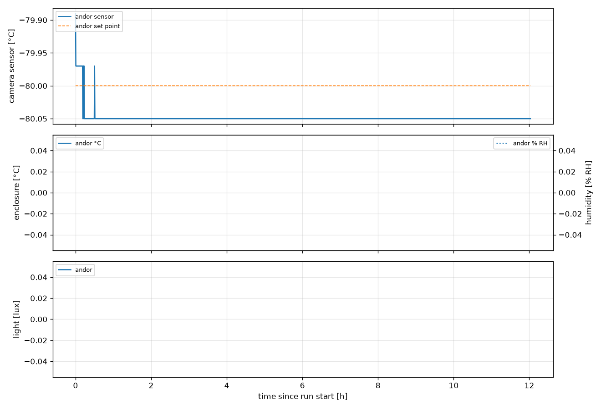
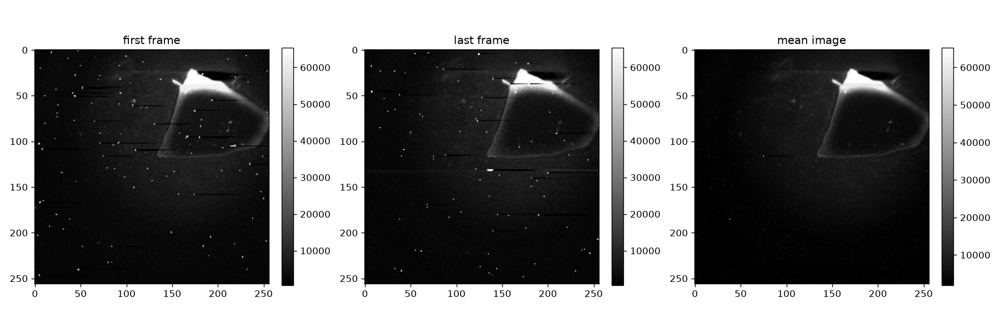
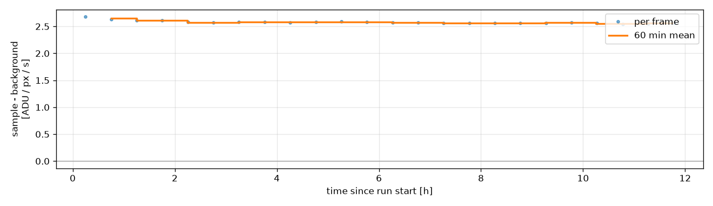

# E3 - Andor EMCCD, long exposures over time

Back-to-back 30 min exposures of an injured leaf in 2 % H2O2 on the Andor iXon DU888 EMCCD (4x4 binning, EM gain 300, 1 MHz, deep cooling) until the leaf dries out (~12 h). Same protocol as E4 on the ToupTek. **Run this first**: it answers whether the sample glows above background and how strongly, which sets the frame time for E1 and tells us whether the ToupTek has a chance.

| | |
|---|---|
| Run | `2026-10-27_19-34-50_cress_h2o2` |
| Experiment | E3 |
| Server / detector | http://192.168.178.50:80/imswitch/api / Andor |
| Frames | 24 |
| First / last frame | 2026-10-27T19:34:52 / 2026-10-28T07:06:34 |
| Sample species | Lepidium sativum (garden cress) |
| Sample treatment | injured + 2 % H2O2 |

## Summary

- **frames:** 24
- **mode:** integrated
- **unit:** ADU / px / s
- **total_exposure_h:** 12
- **time_axis:** since run start
- **rois:** {'sample': None, 'background': None}
- **warning:** no sample ROI set: whole frame used
- **warning:** no background ROI or offset: rates include the camera offset
- **rate:** 2.58
- **rate_error:** 0.005892
- **camera_temperature_c_min_max:** [-80.05, -79.89]

## Figures





## Settings

```json
{
  "kind": "timecourse",
  "experiment": "E3",
  "sample": {
    "species": "Lepidium sativum (garden cress)",
    "treatment": "injured + 2 % H2O2",
    "prepared_at": null,
    "notes": ""
  },
  "server": "http://192.168.178.50:80/imswitch/api",
  "detector": "Andor",
  "dry_run": false,
  "camera_settings": {
    "output_amplifier": "Electron Multiplying",
    "readout_rate": "1 MHz",
    "gain": 300,
    "binning": 4,
    "cooler": true,
    "target_temperature": -80
  },
  "camera_readback": {
    "output_amplifier": "Electron Multiplying",
    "readout_rate": "1 MHz",
    "gain": 300,
    "binning": 4,
    "cooler": true,
    "target_temperature": -80
  },
  "steps": [
    {
      "label": "frame",
      "exposure_ms": 1800000,
      "n_frames": null,
      "duration_s": 43200
    }
  ],
  "analysis": {
    "mode": "integrated",
    "label": "frame",
    "window_min": 60,
    "e_per_adu": null,
    "em_gain": 300
  },
  "rois": {
    "sample": null,
    "background": null
  }
}
```

## Files

- `config.json` settings, `events.log` timeline, `frames.csv` one row per frame
- `environment.csv` camera and enclosure log, `analysis.csv` per-frame results
- `raw/` 24 full bit-depth TIFFs
- `report.ipynb` redraws every figure from this folder (run all cells)
