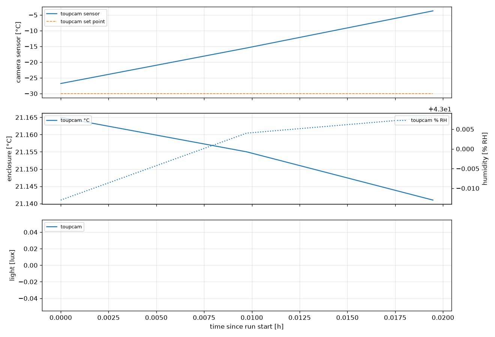
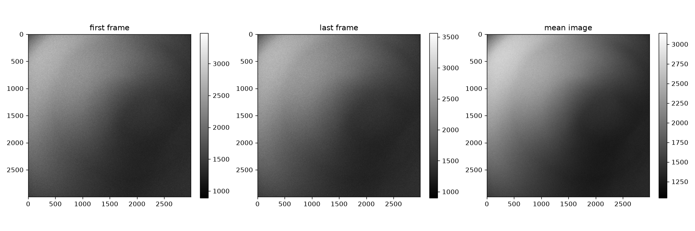
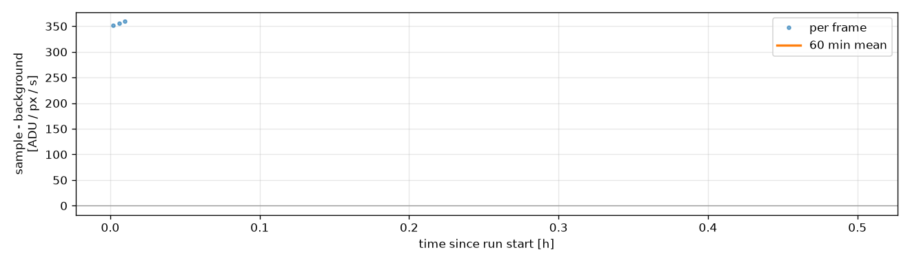

# E4 - ToupTek, long exposures over time

Back-to-back 30 min exposures of an injured leaf in 2 % H2O2 on the ToupTek MTR3CMOS09000KMA (IMX533, 3.76 µm pixels) at maximum gain, high conversion gain, a fixed black level and -30 °C, until the leaf dries out (~12 h). Same protocol as E3 on the Andor, so the two compare frame for frame.

| | |
|---|---|
| Run | `2026-10-24_14-13-00_cress_h2o2` |
| Experiment | E4 |
| Server / detector | http://localhost:8001/imswitch/api / WidefieldCamera |
| Frames | 3 |
| First / last frame | 2026-10-24T14:13:32 / 2026-10-24T14:14:00 |
| Sample species | Lepidium sativum (garden cress) |
| Sample treatment | injured + 2 % H2O2 |
| **Dry run** | short test exposures, not data |

## Summary

- **frames:** 3
- **mode:** integrated
- **unit:** ADU / px / s
- **total_exposure_h:** 0.004
- **time_axis:** since run start
- **rois:** {'sample': None, 'background': None}
- **warning:** no sample ROI set: whole frame used
- **warning:** no background ROI or offset: rates include the camera offset
- **rate:** 356
- **rate_error:** 2.04
- **camera_temperature_c_min_max:** [-26.8, -3.7]
- **enclosure_temperature_c_min_max:** [21.141, 21.165]
- **humidity_pct_min_max:** [42.987, 43.008]

## Figures





## Settings

```json
{
  "kind": "timecourse",
  "experiment": "E4",
  "sample": {
    "species": "Lepidium sativum (garden cress)",
    "treatment": "injured + 2 % H2O2",
    "prepared_at": null,
    "notes": ""
  },
  "server": "http://localhost:8001/imswitch/api",
  "detector": "WidefieldCamera",
  "dry_run": true,
  "camera_settings": {
    "exposure_mode": "manual",
    "pixel_format": "mono16",
    "conversion_gain": "HCG",
    "low_noise": true,
    "gain": 23,
    "blacklevel": 1000,
    "target_temperature": -30
  },
  "camera_readback": {
    "exposure_mode": "manual",
    "pixel_format": "mono16",
    "conversion_gain": "HCG",
    "low_noise": true,
    "gain": 23.0,
    "blacklevel": 1000,
    "target_temperature": -30.0
  },
  "steps": [
    {
      "label": "frame",
      "exposure_ms": 5000,
      "n_frames": 3,
      "duration_s": null
    }
  ],
  "analysis": {
    "mode": "integrated",
    "label": "frame",
    "window_min": 60,
    "e_per_adu": null,
    "offset_adu": null,
    "em_gain": 1
  },
  "rois": {
    "sample": null,
    "background": null
  }
}
```

## Files

- `config.json` settings, `events.log` timeline, `frames.csv` one row per frame
- `environment.csv` camera and enclosure log, `analysis.csv` per-frame results
- `raw/` 3 full bit-depth TIFFs
- `report.ipynb` redraws every figure from this folder (run all cells)
