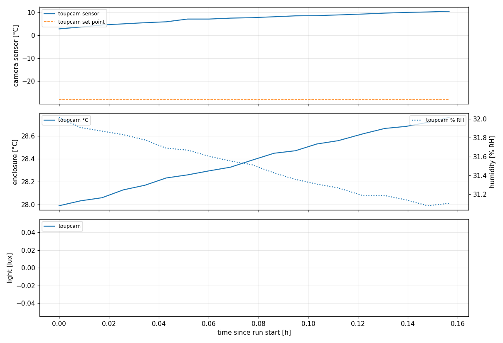
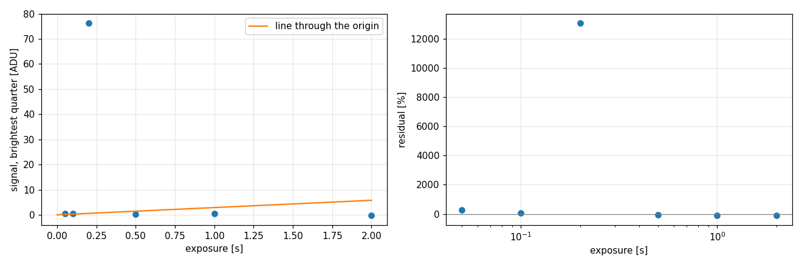

# S1 - calibration, ToupTek MTR3CMOS09000KMA (IMX533)

Bias, photon transfer and linearity with the beta light in the infinity space, dark current over the ladder, beta light at the sample plane.

| | |
|---|---|
| Run | `2026-11-12_19-51-49_toupcam_calibration` |
| Experiment | S1_calibration |
| Server / detector | http://localhost:8001/imswitch/api / WidefieldCamera |
| Frames | 52 |
| First / last frame | 2026-11-12T19:52:07 / 2026-11-12T20:01:22 |
| **Dry run** | short test exposures, not data |

## Summary

- **excess_noise_sq:** 1
- **pixel_step:** 2
- **offset_adu:** 917.2
- **read_noise_adu:** 54.91
- **bias_frames:** 4
- **adu_per_e:** -96.83
- **e_per_adu:** -0.01033
- **ptc_slope_adu:** -96.83
- **ptc_intercept_adu2:** 1122
- **ptc_rel_residual_rms:** 2.029
- **ptc_signal_range_adu:** [2.8896458527767392, 78.76880806275506]
- **read_noise_e:** -0.5671
- **linearity_slope_adu_s:** 2.892
- **linearity_max_residual_pct:** 1.307e+04
- **linearity_exposures_s:** [0.05, 0.1, 0.2, 0.5, 1.0, 2.0]
- **dark_current_adu_px_s:** 21.49
- **dark_current_e_px_s:** -0.222
- **dark_note:** from the short ladder; S2 dark frames give it at the run exposure
- **camera_temperature_c_min_max:** [2.9, 10.6]
- **enclosure_temperature_c_min_max:** [27.988, 28.76]
- **humidity_pct_min_max:** [31.078, 32.016]

## Figures





## Settings

```json
{
  "experiment": "S1_calibration",
  "server": "http://localhost:8001/imswitch/api",
  "detector": "WidefieldCamera",
  "camera": "toupcam",
  "camera_preset": {
    "label": "ToupTek MTR3CMOS09000KMA (IMX533)",
    "detector": null,
    "backend": "recording",
    "settings": {
      "exposure_mode": "manual",
      "pixel_format": "mono16",
      "conversion_gain": "HCG",
      "low_noise": true,
      "gain": 23,
      "blacklevel": 1000,
      "target_temperature": -28
    },
    "cooldown": {
      "tolerance_c": 1.0,
      "timeout_s": 2700
    },
    "settle_s": 1200,
    "excess_noise_sq": 1.0,
    "pixel_um": 3.76,
    "readout_binning": 1,
    "image_binning": 4,
    "full_scale_adu": 16383,
    "transient_dilate": [
      3,
      3
    ]
  },
  "camera_readback": {
    "exposure_mode": "manual",
    "pixel_format": "mono16",
    "conversion_gain": "HCG",
    "low_noise": true,
    "gain": 23.0,
    "blacklevel": 1000,
    "target_temperature": -28.0
  },
  "dry_run": true,
  "kind": "slim_calibration",
  "optics": {
    "name": "4x/0.20 pair",
    "magnification": 1.0
  },
  "steps": [
    {
      "label": "bias",
      "shutter": "closed",
      "exposure_ms": 1,
      "n_frames": 4
    },
    {
      "label": "ptc_light",
      "shutter": "open",
      "exposure_ms": 50,
      "n_frames": 4
    },
    {
      "label": "ptc_dark",
      "shutter": "closed",
      "exposure_ms": 50,
      "n_frames": 4
    },
    {
      "label": "ptc_light",
      "shutter": "open",
      "exposure_ms": 100,
      "n_frames": 4
    },
    {
      "label": "ptc_dark",
      "shutter": "closed",
      "exposure_ms": 100,
      "n_frames": 4
    },
    {
      "label": "ptc_light",
      "shutter": "open",
      "exposure_ms": 200,
      "n_frames": 4
    },
    {
      "label": "ptc_dark",
      "shutter": "closed",
      "exposure_ms": 200,
      "n_frames": 4
    },
    {
      "label": "ptc_light",
      "shutter": "open",
      "exposure_ms": 500,
      "n_frames": 4
    },
    {
      "label": "ptc_dark",
      "shutter": "closed",
      "exposure_ms": 500,
      "n_frames": 4
    },
    {
      "label": "ptc_light",
      "shutter": "open",
      "exposure_ms": 1000,
      "n_frames": 4
    },
    {
      "label": "ptc_dark",
      "shutter": "closed",
      "exposure_ms": 1000,
      "n_frames": 4
    },
    {
      "label": "ptc_light",
      "shutter": "open",
      "exposure_ms": 2000,
      "n_frames": 4
    },
    {
      "label": "ptc_dark",
      "shutter": "closed",
      "exposure_ms": 2000,
      "n_frames": 4
    }
  ],
  "analysis": {
    "pixel_step": 2
  }
}
```

## Files

- `config.json` settings, `events.log` timeline, `frames.csv` one row per frame
- `environment.csv` camera and enclosure log, `analysis.csv` per-frame results
- `raw/` 52 full bit-depth TIFFs
- `report.ipynb` redraws every figure from this folder (run all cells)
