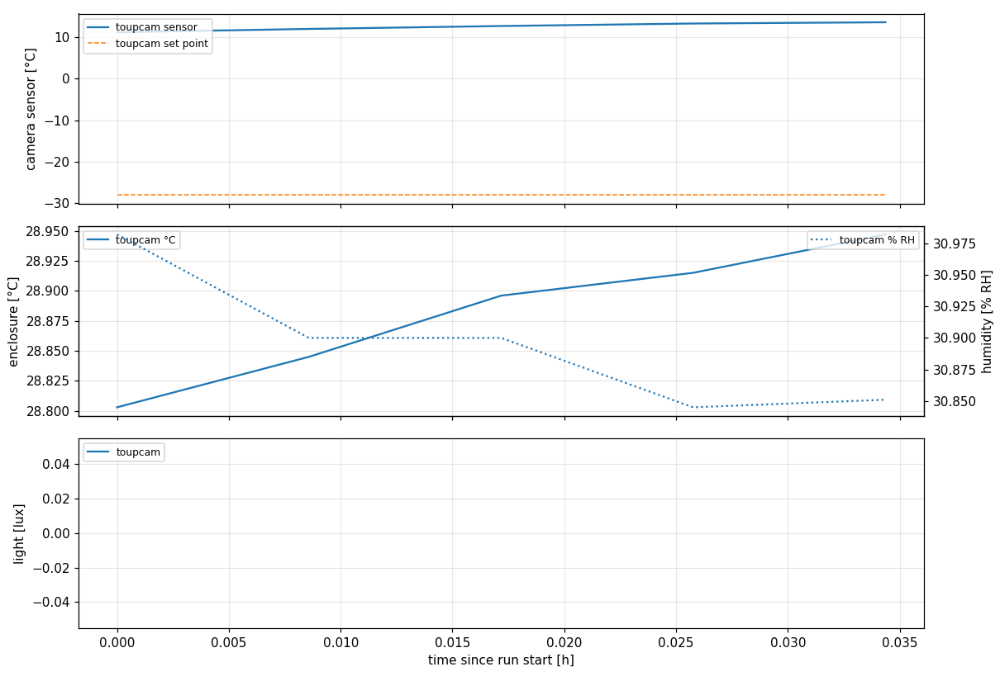
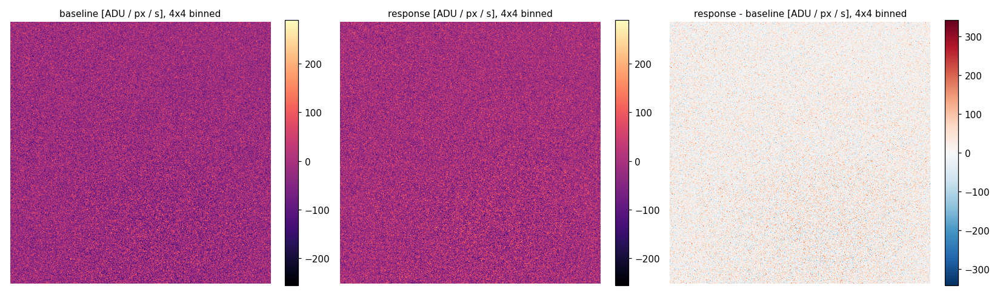
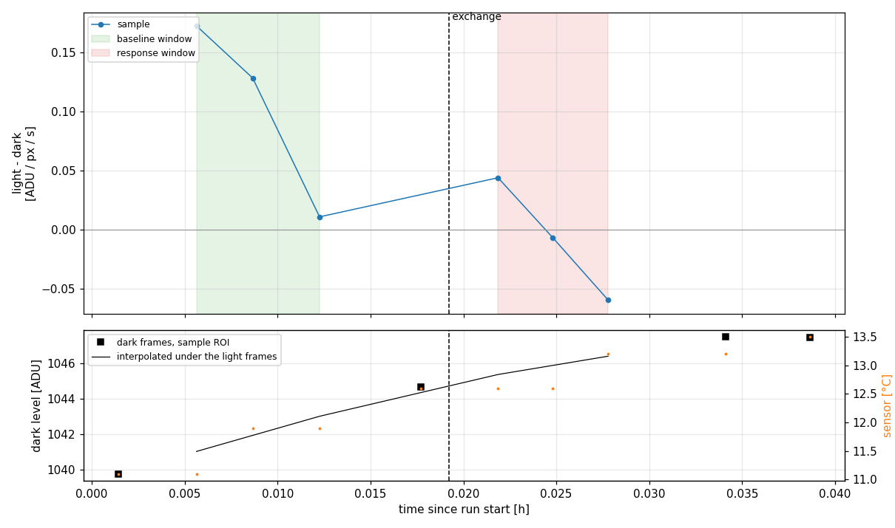

# S2 - cress_01: water then h2o2

injured leaf in the flow chamber, water baseline, exchange to h2o2, dark frames from the shutter during the run.

| | |
|---|---|
| Run | `2026-11-12_20-02-18_cress` |
| Experiment | S2_leaf_water_h2o2 |
| Server / detector | http://localhost:8001/imswitch/api / WidefieldCamera |
| Frames | 10 |
| First / last frame | 2026-11-12T20:02:25 / 2026-11-12T20:04:39 |
| Sample id | cress_01 |
| Sample species | Lepidium sativum (garden cress) |
| Sample injury | cut |
| Sample h2o2 | 2 % |
| Sample mounted | injured leaf |
| **Dry run** | short test exposures, not data |

## Summary

- **frames_baseline:** 3
- **frames_response:** 3
- **frames_dark:** 4
- **exchange_h:** 0.01922
- **baseline_window_h:** 1.5
- **response_window_h:** 3
- **unit:** ADU / px / s
- **rois:** {'sample': None, 'background': None}
- **warning:** no sample ROI set: whole frame used
- **sample_baseline:** 0.104
- **sample_baseline_sem:** 0.04835
- **sample_response:** -0.007554
- **sample_response_sem:** 0.02996
- **sample_difference:** -0.1116
- **sample_difference_sem:** 0.05688
- **sample_ratio:** -0.07263
- **sample_ratio_err:** nan
- **sample_peak:** 0.04393
- **sample_peak_after_exchange_h:** 0.002639
- **dark_level_adu:** 1046
- **dark_exposure_s:** 5
- **dark_drift_adu:** 7.694
- **camera_temperature_c_min_max:** [11.1, 13.5]
- **enclosure_temperature_c_min_max:** [28.803, 28.947]
- **humidity_pct_min_max:** [30.845, 30.982]

## Figures





## Settings

```json
{
  "experiment": "S2_leaf_water_h2o2",
  "server": "http://localhost:8001/imswitch/api",
  "detector": "WidefieldCamera",
  "camera": "toupcam",
  "camera_preset": {
    "label": "ToupTek MTR3CMOS09000KMA (IMX533)",
    "detector": null,
    "backend": "recording",
    "settings": {
      "exposure_mode": "manual",
      "pixel_format": "mono16",
      "conversion_gain": "HCG",
      "low_noise": true,
      "gain": 23,
      "blacklevel": 1000,
      "target_temperature": -28
    },
    "cooldown": {
      "tolerance_c": 1.0,
      "timeout_s": 2700
    },
    "settle_s": 1200,
    "excess_noise_sq": 1.0,
    "pixel_um": 3.76,
    "readout_binning": 1,
    "image_binning": 4,
    "full_scale_adu": 16383,
    "transient_dilate": [
      3,
      3
    ]
  },
  "camera_readback": {
    "exposure_mode": "manual",
    "pixel_format": "mono16",
    "conversion_gain": "HCG",
    "low_noise": true,
    "gain": 23.0,
    "blacklevel": 1000,
    "target_temperature": -28.0
  },
  "dry_run": true,
  "kind": "slim_leaf",
  "condition": "leaf",
  "sample": {
    "id": "cress_01",
    "species": "Lepidium sativum (garden cress)",
    "injury": "cut",
    "h2o2": "2 %",
    "prepared_at": null,
    "notes": "",
    "mounted": "injured leaf"
  },
  "optics": {
    "name": "4x/0.20 pair",
    "magnification": 1.0
  },
  "steps": [
    {
      "label": "fill",
      "exchange": "water"
    },
    {
      "label": "dark",
      "shutter": "closed",
      "exposure_ms": 5000,
      "n_frames": 1
    },
    {
      "label": "baseline",
      "shutter": "open",
      "exposure_ms": 5000,
      "n_frames": 3
    },
    {
      "label": "dark",
      "shutter": "closed",
      "exposure_ms": 5000,
      "n_frames": 1
    },
    {
      "label": "exchange",
      "exchange": "h2o2"
    },
    {
      "label": "response",
      "shutter": "open",
      "exposure_ms": 5000,
      "n_frames": 3
    },
    {
      "label": "dark",
      "shutter": "closed",
      "exposure_ms": 5000,
      "n_frames": 1
    },
    {
      "label": "dark",
      "shutter": "closed",
      "exposure_ms": 5000,
      "n_frames": 1
    }
  ],
  "analysis": {
    "baseline_window_h": 1.5,
    "response_window_h": 3.0,
    "e_per_adu": null
  },
  "rois": {
    "sample": null,
    "background": null
  }
}
```

## Files

- `config.json` settings, `events.log` timeline, `frames.csv` one row per frame
- `environment.csv` camera and enclosure log, `analysis.csv` per-frame results
- `raw/` 10 full bit-depth TIFFs
- `report.ipynb` redraws every figure from this folder (run all cells)
